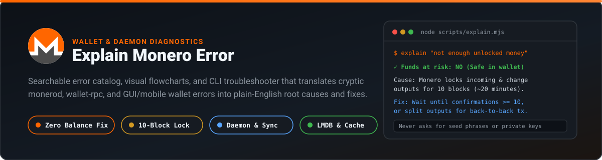
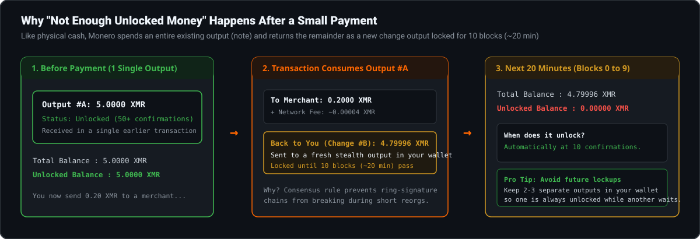
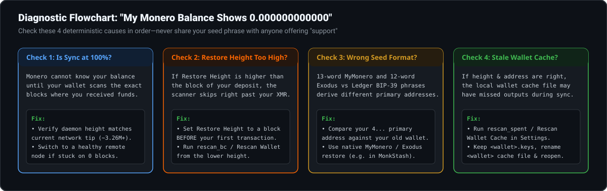

<p align="center">
  
</p>

# Explain Monero Error

Monero's daemon (`monerod`), RPC server (`monero-wallet-rpc`), and wallets (Monero GUI/CLI, Feather, Cake Wallet, and browser wallets) often surface cryptic error messages—such as `not enough unlocked money`, `double spend`, `Sanity check failed on high fee`, `MDB_CORRUPTED`, or a `0.000000000000` balance after restoring from a recovery phrase.

This repository provides:
1. **A structured JSON error catalog** ([`data/errors.json`](data/errors.json)) covering 18 common Monero wallet and node errors, what causes each one, whether funds are at risk, and step-by-step fixes.
2. **A zero-dependency CLI troubleshooter** ([`scripts/explain.mjs`](scripts/explain.mjs)) that matches any pasted error message or symptom offline.
3. **A single-file browser troubleshooter** ([`demo/index.html`](demo/index.html)) that runs locally without network requests.

> **Security Rule #1:** Legitimate troubleshooting never requires your seed phrase or private spend key. Never share your 12, 13, 16, 24, or 25-word recovery phrase with anyone in a support chat, GitHub issue, or web form.

---

## Visual Guide #1: Why "Not Enough Unlocked Money" Happens

The most common panic for new Monero users happens right after sending a small transaction: their remaining balance temporarily shows **`Unlocked balance: 0.000000000000 XMR`**.

<p align="center">
  
</p>

### How to fix or prevent it
- **Wait ~20 minutes (10 blocks):** Your change output unlocks automatically once the transaction reaches 10 confirmations.
- **Pre-split your outputs:** If you need to send multiple transactions in a row without waiting 20 minutes between them, keep 2–4 separate outputs in your wallet so spending one leaves the others unlocked.

---

## Visual Guide #2: Fixing a Missing or Zero (`0.000000000000`) Balance

<p align="center">
  
</p>

For step-by-step instructions by symptom:
- [Monero Wallet Not Showing Balance](https://monkstash.com/monero-wallet-not-showing-balance)
- [Monero Wallet Not Syncing](https://monkstash.com/monero-wallet-not-syncing)
- [Monero Wallet Not Connecting](https://monkstash.com/monero-wallet-not-connecting)
- [Monero Restore Height Calculator](https://monkstash.com/tools/monero-restore-height-calculator)

---

## Quick Error Lookup Table

| Literal Error / Symptom | Category | Funds Safe? | Root Cause & Quick Fix |
| :--- | :--- | :---: | :--- |
| `not enough unlocked money` | Balance | **Yes** | Change or incoming output has `< 10` confirmations (~20 min consensus lock). Wait until 10 confirmations. |
| `Balance is 0.000000000000 after restore` | Restore | **Yes** | Sync incomplete, Restore Height set higher than deposit block, or seed format mismatch ([fix guide](https://monkstash.com/monero-wallet-not-showing-balance)). |
| `restore height is higher than...` | Restore | **Yes** | Restore height was set in the future or entered as a timestamp. Look up the right block height at [MonkStash Restore Height Calculator](https://monkstash.com/tools/monero-restore-height-calculator). |
| `13-word MyMonero seed wrong address` | Restore | **Yes** | MyMonero hashes the unreduced first Keccak digest (`keccak256(keccak256(seed16))`). Restore via [MonkStash MyMonero Restore](https://monkstash.com/restore-mymonero-seed). |
| `12-word Exodus seed empty wallet` | Restore | **Yes** | Exodus derives `m/44'/128'/0'/0/0` and reduces without Keccak. Restore via [MonkStash Exodus Recovery](https://monkstash.com/exodus-monero). |
| `no connection to daemon` | Network | **Yes** | Local `monerod` isn't running or remote RPC port (`18089`/`443`) is unreachable ([connection guide](https://monkstash.com/monero-wallet-not-connecting)). |
| `daemon returned status: busy` | Network | **Yes** | Node is syncing a block batch or overloaded (`CORE_BUSY`). Wait 60s or switch remote nodes. |
| `SSL handshake failed` / CORS error | Network | **Yes** | TLS mismatch on port, or browser wallet blocked because remote node lacks `https://` + `Access-Control-Allow-Origin`. |
| `double spend` / `key image already spent` | Tx | **Yes** | Local wallet cache tried to spend an output already spent on another device or in mempool. Run `rescan_spent`. |
| `Sanity check failed on high fee` | Tx | **Yes** | Remote node returned an abnormally high fee quote. Switch nodes immediately and check [Monero Fee Calculator](https://monkstash.com/tools/monero-fee-calculator). |
| `not enough money` (when sending max) | Tx | **Yes** | Network fee must be deducted from total balance. Use **Max / Sweep All** (`sweep_all`). |
| `tx_extra has invalid format` | Tx | **Yes** | Legacy standalone 64-hex Payment IDs were removed in v0.15. Use a modern `8...` [Subaddress](https://monkstash.com/monero-subaddress). |
| `Transaction stuck in Pending (0/10)` | Tx | **Yes** | Remote node failed to relay tx to P2P network. Check txid in [Transaction Lookup](https://monkstash.com/monero-transaction-lookup), switch nodes, and `rescan_spent`. |
| `Failed to lock lmdb` / `data.mdb` | Database | **Yes** | Another `monerod` process is already running or still flushing LMDB pages to disk. |
| `MDB_CORRUPTED` / `Bus error` | Database | **Yes** | Unclean shutdown during LMDB write. Run `monerod --db-salvage` or resync a [pruned node](https://monkstash.com/monero-pruned-node). |
| `Invalid password` (when password is right) | Files | **Yes** | Local `<wallet>` cache file corrupted on exit while `<wallet>.keys` is intact. Rename `<wallet>` to `<wallet>.old` and reopen. |
| `Trojan:Win32/CoinMiner` (`monerod.exe`) | OS / AV | **Yes** | Antivirus false positive on `monerod`'s built-in RandomX solo miner ([verification & fix guide](https://monkstash.com/monero-gui-virus-warning)). |
| `SW=0x6985` / `SW=0x6e00` (Ledger) | Hardware | **Yes** | Prompt rejected on device (`0x6985`) or Ledger Live is locking USB / Monero app closed (`0x6e00`). |

---

## Using the CLI Troubleshooter

No `npm install` is required—the CLI uses only built-in Node.js modules.

```bash
# Explain a specific error string or symptom
node scripts/explain.mjs "not enough unlocked money"
node scripts/explain.mjs "key image already spent"
node scripts/explain.mjs "SW=0x6985"

# List all 18 error IDs in the catalog
node scripts/explain.mjs --list
```

Example output:

```text
------------------------------------------------------------
ERROR      : Not enough unlocked money (10-Block Change Output Lock)
ID         : not-enough-unlocked-money (balance-and-restore)
FUNDS SAFE : No — your funds are in your wallet and will unlock automatically.

WHY IT HAPPENS:
  Monero transactions consume an entire existing output (like paying for a $5 coffee with a $100 bill)
  and return the remainder to your wallet as a brand-new change output. Consensus rules lock both newly
  received outputs and change outputs for 10 blocks (~20 minutes) to protect ring signatures against
  shallow chain reorganizations.

HOW TO FIX IT:
  1. Wait until your most recent transaction reaches 10 confirmations (~20 minutes on average).
  2. If you frequently send back-to-back payments, split your balance into 3–5 separate outputs...
------------------------------------------------------------
```

---

## Interactive Offline Browser Demo

Open [`demo/index.html`](demo/index.html) directly in any browser to search errors interactively with instant filtering.

---

## License

Released under the [MIT License](LICENSE).
